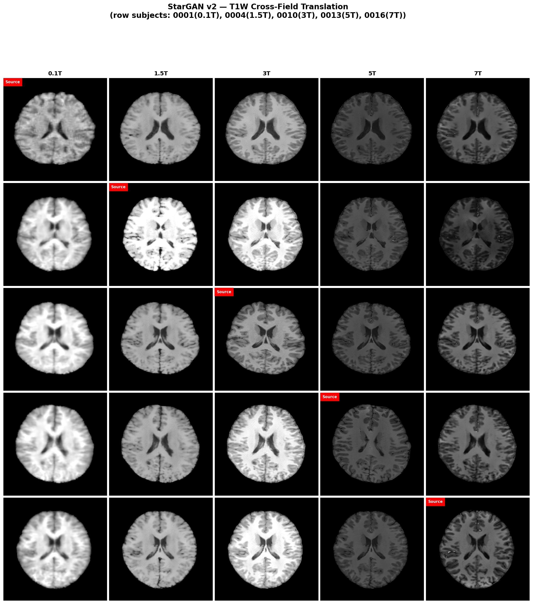
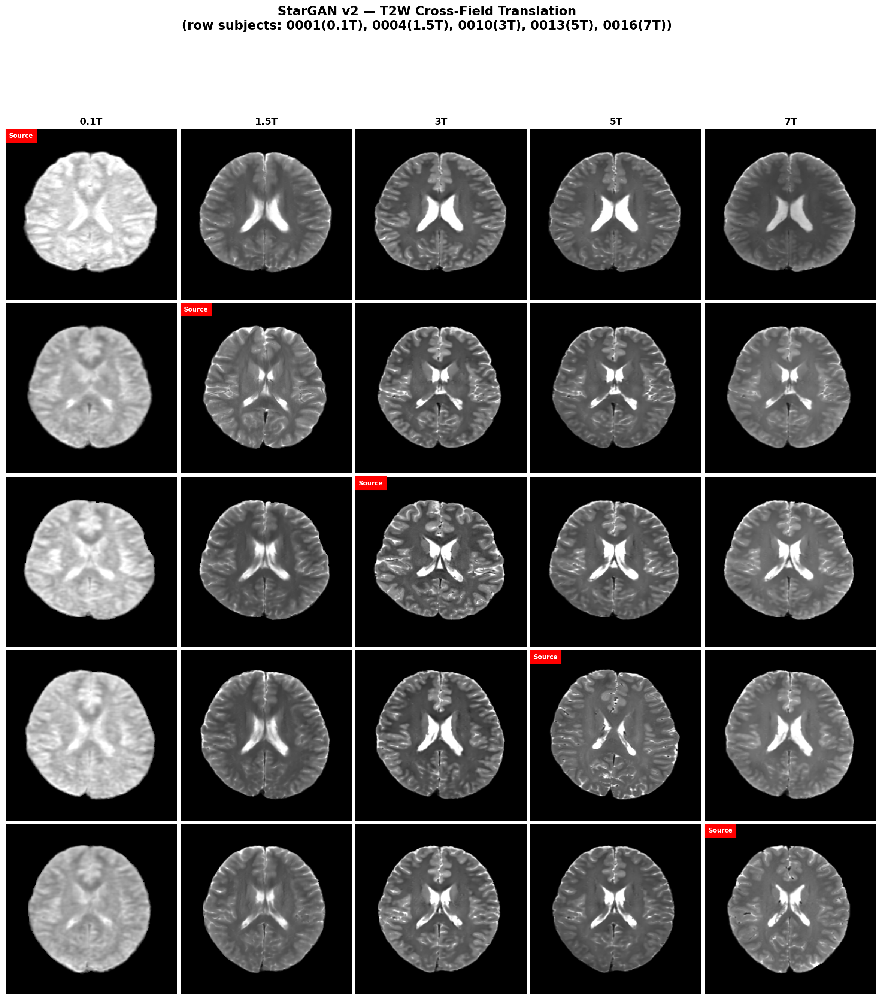
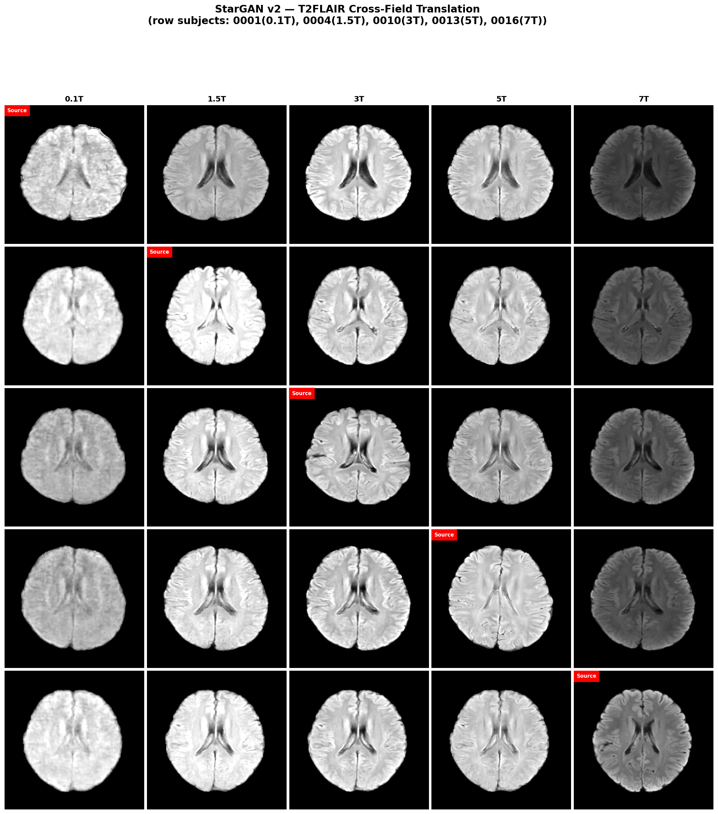

# StarGAN v2 + U-Net + MoE-FiLM — MRIxFields2026 Task 3

Controllable **any-to-any cross-field MRI translation** with a *single* field-conditioned model:
5 magnetic field strengths (0.1T, 1.5T, 3T, 5T, 7T) × 3 contrasts (T1W, T2W, T2-FLAIR) = 15 domains,
20 directed field pairs (including downfield pairs such as 7T → 0.1T).

This repository is the **Task 3** code of our MRIxFields2026 challenge entry.

---

## Paper

> **Field-Conditioned MRI Field-Strength Translation for the MRIxFields2026 Challenge**
>
> Jiacai Cai, Xinyuan Xu, **Yuming Xia**, Bo Zhang, Yilong Liu, Mengye Lyu
>
> *Medical Image Computing and Computer Assisted Intervention — MICCAI 2026 Workshops and Challenges*,
> Springer Nature Switzerland, **LNCS 17274** (2026).
>
> - Abstract page: <https://papers.miccai.org/miccai-2026-sat/MRIxFields2026_003.html>
> - Open-access PDF: <https://papers.miccai.org/miccai-2026-sat/paper/MRIxFields2026_003.pdf>

**Author note.** Yuming Xia is a co-first author of this paper (listed third in the author order) and
independently designed and implemented the **Task 3** module — i.e. everything in this repository.
In the paper, Task 3 is the unified StarGAN v2-based conditional model over all 15 field-strength ×
contrast domains; Tasks 1 and 2 (contrast-specific field-conditioned CycleHCUT models) are not part of
this repository.

```bibtex
@InProceedings{CaiJia_FieldConditioned_MICCAISAT2026,
  author    = {Cai, Jiacai AND Xu, Xinyuan AND Xia, Yuming AND Zhang, Bo AND Liu, Yilong AND Lyu, Mengye},
  title     = {{Field-Conditioned MRI Field-Strength Translation for the MRIxFields2026 Challenge}},
  booktitle = {Medical Image Computing and Computer Assisted Intervention -- MICCAI 2026
               Workshops and Challenges},
  year      = {2026},
  publisher = {Springer Nature Switzerland},
  volume    = {LNCS 17274}
}
```

Reported scores in the paper are **validation-stage** leaderboard values and may differ from the final
test-phase evaluation.

---

## 1. The task, and why the architecture looks like this

MRIxFields2026 is the first public multi-field brain-MRI benchmark spanning 0.1T–7T
([challenge site](https://mrixfields.chihucloud.com/2026/) ·
[data/code](https://github.com/MRIxFields/MRIxFields2026)). **Task 3** asks for
*controllable field-to-field synthesis from a single unified conditional model*, where both the source
and the target field strength are explicit inputs.

| Item | Task 3 setting |
|---|---|
| Subtasks | 20 directed pairs (5 sources × 4 targets, **including downfield**) × 3 contrasts = 60 directories |
| Submission content | `pred/` only — Task 3 is scored on **voxel-level metrics**, `seg/` is ignored |
| Metrics | nRMSE ↓, SSIM ↑, LPIPS ↓ (3 metrics); per-metric ranks are summed, lowest total wins |
| Prediction format | NIfTI `.nii.gz`, float32, shape `(364, 436, 30)`, intensity in `[0, 1]`, 0.5 mm MNI grid, axial slab z ∈ `[150, 180)` |
| Validation cohort | paired travelling volunteers scanned at all 5 fields × 3 contrasts; the public input release exposes a small number of subject IDs per source field |

The rule that shapes the whole design (challenge FAQ §7, Task 3 constraints):

> one set of pretrained parameters only; decomposing the task into field-specific, target-specific or
> source–target-pair-specific sub-networks selected by a router is **not** allowed; Mixture-of-Experts
> modules are allowed **only** when they are part of a single end-to-end model with substantial sharing
> and are not dedicated exclusively to fixed fields, contrasts or translation pairs.

Our conditioning modules satisfy this by construction: the experts are partitioned by **decoder depth**,
not by field or contrast, and every expert is evaluated for all 15 domains on every forward pass
(see §3). There is no router and no per-pair parameter set.

---

## 2. Results (validation stage)

Recorded Synapse validation submissions from the `final`-line recipe (`bal_*` configs):

| Phase | Submission | SSIM ↑ | nRMSE ↓ | LPIPS ↓ | Files |
|---|---|---|---|---|---|
| Phase 1 — pretrain (`retro_scratch`, 36k iters) | `9769732.zip` | 0.8026 | 0.5154 | 0.1603 | 180 / 180 |
| Phase 2 — fine-tune (`pro_pretrained`, 50 epochs) | `9769728.zip` | **0.9003** | **0.2361** | **0.0824** | 180 / 180 |

Per-contrast breakdown of the fine-tuned submission (overall mean = 0.900251):

| Metric | T1W | T2W | T2FLAIR |
|---|---|---|---|
| SSIM ↑ | 0.9026 | 0.9055 | 0.8926 |
| nRMSE ↓ | 0.2507 | 0.2657 | 0.1920 |
| LPIPS ↓ | 0.0796 | 0.0826 | 0.0851 |

180 files = 20 pairs × 3 contrasts × 3 subjects per source field, i.e. the full validation release.

Other numbers that exist in this repository, for completeness:

| Source | Stage | SSIM ↑ | nRMSE ↓ | LPIPS ↓ |
|---|---|---|---|---|
| Paper (Cai et al., Task 3) | validation | 0.901 | — | — |
| `moe_3expert_v2` branch README (self-reported, no raw artifacts committed) | pretrain (best @ 23 360) | 0.8380 | 0.5038 | 0.1560 |
| `moe_3expert_v2` branch README (self-reported) | fine-tune | 0.8999 | 0.2384 | 0.0852 |

### Qualitative results

Figures committed under `picture/` (regenerate them with `Baseline/scripts/visualize.py`). Layout: five
subjects, one row each — IDs 0001 / 0004 / 0010 / 0013 / 0016, acquired at 0.1T / 1.5T / 3T / 5T / 7T
respectively. The red-labelled diagonal cell is that subject's acquired input; the other four cells are
the model's cross-field translations. The 0.1T column keeps its noisy, low-contrast character and the 7T
column stays crisp, i.e. the model reproduces field-specific appearance rather than collapsing every
direction onto one "clean" output. (The checkpoint behind these figures is not recorded in the
repository.)

**T1W**



**T2W**



**T2-FLAIR**



---

## 3. Architecture (`final` branch — 4-expert MoE-FiLM)

```
  x (B, 1, 512, 512)                              target condition
          │                                    (y_trg, modality, z | x_ref)
          │                                              │
          │                        ┌─────────────────────┴──────────────────────┐
          │                        ▼                                            ▼
          │              MappingNetwork(z, y_trg)                StyleEncoder(x_ref, y_trg)
          │                        └──────────────── s_trg (64 d) ───────────────┘
          │
          ├── SharedMappingNetwork(z(16), modality_onehot(3), field(1)) ──► S (192 d)
          │       S         = [ s_T1W(64) | s_T2W(64) | s_T2FLAIR(64) ]
          │       s_use     = S[:, m*64 : (m+1)*64]     ← target-contrast segment
          │       s_use_sc  = S[:, msrc*64 : ...]       ← source segment (cycle / identity)
          │
          └── FiLMUnetStarGANv2Generator
                encoder   from_rgb → 4 down-ResBlks (feat0..feat3)
                          → 1 down-ResBlk + 2 bottleneck ResBlks
                          feat0 (256², 64)   feat1 (128², 128)   feat2 (64², 256)
                          feat3 (32², 512)   bottleneck (16², 512)
                                    │ GAP of each
                                    ▼
                FourExpertFiLM(s_use, z_src, feat3_gap, feat2_gap, feat0_gap, bottleneck_gap)
                          ├─ Expert0   film layers  0–3    s_use(64) + bottleneck_gap(512) + z_src(1) = 577
                          ├─ Expert1   film layers  4–7    s_use(64) + feat3_gap(512)      + z_src(1) = 577
                          ├─ Expert2   film layers  8–11   s_use(64) + feat2_gap(256)                 = 320
                          └─ Expert3   film layers 12–13   s_use(64) + feat0_gap(64)                  = 128
                          → [γ_e, β_e]  (14 FiLM points)
                FieldMLP(s_use, z_src) → [γ_f, β_f]  (14 FiLM points)
                          γ = γ_e + γ_f ,   β = β_e + β_f
                                    ▼
                decoder   7 AdaIN blocks, each additively modulated by (γ, β)
                          decode[2..5] fused with the matching encoder skip (SkipFusion)
                          to_rgb → Tanh → (B, 1, 512, 512)
```

### Modules

| Module | File | Role |
|---|---|---|
| `FiLMUnetStarGANv2Generator` | `Baseline/mrixfields/models/unet_generator.py` | U-Net StarGAN v2 generator; FiLM injected into all 14 decoder conditioning points |
| `SkipFusion` | `models/skip_fusion.py` | 1×1 conv fusing encoder skip with decoder feature; **identity-initialised** so the skip starts as decoder passthrough |
| `SharedMappingNetwork` | `models/moe_mapping.py` | `(z, modality_onehot, field) → S(192)`, split into three 64-d contrast segments; last layer zero-init |
| `FourExpertFiLM` | `models/film.py` | 4 expert MLPs hard-assigned to non-overlapping decoder-depth ranges; **no router, no softmax** |
| `FieldMLP` | `models/film.py` | Continuous field-strength modulation added on top of the expert output |
| `LaplacianAttention` | `models/laplacian_attention.py` | Multi-scale Laplacian edge attention (SENet-style channel + spatial) inside the StyleEncoder |
| `MultiScaleDiscriminator` | `models/stargan_v2.py` | 3-scale StarGAN v2 discriminator (adv + R1) |
| `ZtoFiLM` / `DynamicZtoFiLM` | `models/film.py` | Alternative static / content-adaptive FiLM paths (`use_film`, `use_dynamic_film`) |
| `SkipFusionExpert` | `models/skip_fusion_experts.py` | Optional γ-only texture modulation of skip features (`use_skipfusion_experts`, disabled in all shipped configs) |

Parameter counts for the shipped configuration (`img_size=512`, `style_dim=64`, `num_domains=15`):

| Component | Params |
|---|---|
| Generator (incl. SkipFusion 0.70 M + FourExpertFiLM 0.69 M + FieldMLP 0.59 M) | 35.9 M |
| StyleEncoder (incl. LaplacianAttention) | 21.5 M |
| MappingNetwork | 13.1 M |
| MultiScaleDiscriminator | 62.5 M |
| SharedMappingNetwork | 0.6 M |
| **Total** | **133.7 M** |

(The conditioning-module figures follow by direct parameter counting from the code; the totals are as
printed by the training script's startup module audit.)

### Key design decisions

- **Depth-partitioned experts, not field-partitioned.** Expert *k* owns decoder FiLM points, so every
  expert serves all 5 fields and all 3 contrasts; field/contrast identity enters only through the shared
  `s_use` / `z_src` inputs. This is what keeps the model T3-compliant (§1).
- **No router.** An earlier 2-expert soft-routed `MoEFiLM` variant (with `layer_bias`, softmax blending
  and a load-balancing loss) is still in `film.py` but marked `DEPRECATED`; it is not built by any
  config. The 4-expert design removes the router entirely.
- **Additive field modulation.** `γ = γ_expert + γ_field` keeps the discrete contrast code and the
  continuous field scalar separable, so the same weights serve all 20 translation directions.
- **Zero-init on every last linear layer.** FiLM starts as the identity; a fresh conditioning head never
  perturbs a pretrained generator.
- **Identity-init SkipFusion.** The 1×1 fusion conv is initialised so `conv(cat([enc, dec])) = dec` at
  step 0; encoder detail is blended in over training instead of injected abruptly.
- **Single-channel slices.** All shipped configs use `input_nc: 1` and 512×512 axial slices; the
  multi-channel (2.5D) code paths exist (`x[:, 1:2]` centre-channel handling) but are not used here.

---

## 4. Two-phase training

Everything is driven by one entry point, `Baseline/scripts/train.py`, and one YAML per phase.

### Phase 1 — `retro_scratch` (unpaired pretraining)

15-domain adversarial training on the unpaired retrospective cohort
(`DATA_DIR/Training_retrospective`, i.e. different subjects per field strength).

| Parameter | `bal_pretrain.yaml` (submission recipe) | `jun30_pretrain.yaml` |
|---|---|---|
| Iterations | 36 000 | 60 000 |
| Batch size | 8 global (`batch_size // world_size` → 1 per rank at 8 ranks) | 8 global |
| LR / schedule | 1e-4, cosine decay from step 20 000 | 1e-4, cosine from 40 000 |
| `ds_iter` (style/diversity ramp) | 18 000 | 30 000 |
| λ_cyc / λ_cyc_lpips / λ_cyc_ssim | 1.0 / 0.015 / 0.1 | same |
| λ_freq / λ_mssim | 0.2 / 0.15 | 0.15 / 0.1 |
| λ_reg (R1) / λ_lpips_direct | 3.0 / 0.05 | 1.0 / 0.05 |
| Checkpoint selection | `auto_save_best` α=2.0, min_step 25 000, top-k 3 | min_step 30 000 |

Generator objective (from `compute_g_loss`, `models/stargan_v2.py:573-757`), with the adversarial term
weighted 1.0 and λ_sty = λ_ds = 1.0 ramped by `min(1, step/ds_iter)`:

```
L_G = adv  +  λ_sty·style  −  λ_ds·diversity  +  λ_cyc·cycle(L1)
      +  λ_cyc_lpips·cycle(LPIPS)  +  λ_cyc_ssim·SSIM   ← sign error as written, see §9.1
      +  λ_lpips_direct·LPIPS(fake, real)  +  λ_freq·FFT-L1  +  λ_mssim·(1−MS-SSIM)
      +  λ_id_l1·id(L1)  +  λ_id_lpips·id(LPIPS)  +  λ_id_ssim·id(SSIM)   ← same, but λ_id_ssim = 0 in all shipped configs
```

### Phase 2 — `pro_pretrained` (paired fine-tuning)

Warm-started from the Phase-1 best checkpoint and fine-tuned on the paired travelling-volunteer cohort
(`DATA_DIR/Training_prospective`). 60 same-contrast `(contrast, src_field, tgt_field)` pairs are built
(the code explicitly notes that cross-contrast pairing is not defined), then sampled jointly.

| Parameter | `bal_finetune.yaml` |
|---|---|
| Epochs | 50 |
| Batch size | 8 global (`batch_size // world_size` → 1 per rank at 8 ranks) |
| LR | 2e-5 (Adam) |
| Loss weights | L1 0.5, LPIPS 0.25, SSIM 0.2 (as `1−SSIM`), retrospective replay 1.5 |
| Retrospective replay ratio | 0.5 (replay batch drawn from `retro_train`, own-domain identity objective) |
| EWC | `lambda_ewc: 3.0` — **inert, see §9** |
| EMA | β = 0.9999 |
| Encoder freeze | `freeze_encoder.enabled: false` |
| Optimiser scope | generator + mapping network + `moe_mapping` only — **the discriminator is not updated** |

Effective fine-tune loss (`train.py:1215-1220`):

```
L = 0.5·L1(pred, tgt) + 0.25·LPIPS(pred, tgt) + 0.2·(1−SSIM)(pred, tgt) + 1.5·L1(replay)
```

### Checkpoint selection during pretraining

When `monitor.enabled` is set, the EMA generator is run on the current training batch and scored with
`score = SSIM − α · nRMSE` (α = 2.0). The top-k (k = 3) checkpoints above `min_step` are kept as
`weights/checkpoint_best_{step}.pth`. Note this is a **self-translation proxy** — the "target" is the
same slice that was fed in — not a held-out target-field comparison.

### Commands

```bash
conda env create -f environment.yml        # once — creates the `mf` environment
conda activate mf
cp .env.example .env && vim .env           # set DATA_DIR / *_DIR to your paths
source .env
cd Baseline

# Phase 1 — unpaired pretraining (8-GPU DDP)
PYTHONUNBUFFERED=1 torchrun --nproc_per_node=8 scripts/train.py \
  --config configs/task3/stargan/bal_pretrain.yaml \
  --mode retro_scratch --dist 2>&1 | tee ../logs/pretrain.log

# Phase 2 — paired fine-tuning
CKPT=$OUTPUT_DIR/stargan_v2_expert_fix/stargan_v2/retro_scratch/weights/checkpoint_best_26000.pth
PYTHONUNBUFFERED=1 torchrun --nproc_per_node=8 scripts/train.py \
  --config configs/task3/stargan/bal_finetune.yaml \
  --mode pro_pretrained --pretrain_ckpt "$CKPT" --dist 2>&1 | tee ../logs/finetune.log
```

`run_630_pretrain.sh` / `run_630_finetune.sh` wrap exactly these two commands (the latter aborts if the
checkpoint is missing). Other CLI flags: `--resume` (auto-discovers the latest checkpoint),
`--device` (defaults to `$DEVICE`), `--dist`. Output goes to
`$OUTPUT_DIR/{task_name}/{method}/{mode}/` with `config_actual.yaml`, `weights/checkpoint_*.pth`,
`weights/checkpoint_best_*.pth` (pretrain) or `weights/checkpoint_epoch{N}.pth` + `metrics.csv`
(fine-tune).

---

## 5. Inference and submission

```bash
python scripts/inference.py \
  --config configs/task3/stargan/bal_finetune.yaml \
  --checkpoint $OUTPUT_DIR/stargan_v2_expert_fix/stargan_v2/pro_pretrained/weights/checkpoint_epoch50.pth \
  --input_dir  $DATA_DIR/Validating_prospective/T1W/0.1T \
  --output_dir $INFERENCE_DIR/T1W/0.1T_to_7T \
  --target_field 7T --target_modality T1W

python Submission/evaluation-2026/score.py --pred_dir "$INFERENCE_DIR" --task 3
```

- `inference.py` converts **one** source→target pair per invocation; the target is given as
  `--target_domain` (0–14, `modality_index*5 + field_index`) or as `--target_field` + `--target_modality`.
  It runs slice-by-slice along the axial axis, crops/pads to 512×512, maps `[0,1] → [-1,1]` in and back
  out, re-orients to the original affine and masks by `src > 1e-6`. Style is sampled once per volume so
  the slices stay consistent. The EMA networks (`nets_ema`) are used when present.
- The **20 directed pairs are enumerated only in the packaging/scoring code**
  (`Submission/build_submission/build_submission.py`, `Submission/evaluation-2026/score.py`,
  `Baseline/scripts/shell/format_metrics.py`) — inference must be looped over all 20 pairs × 3 contrasts.
- `Submission/build_submission/` renames each prediction from the source field tag to the target field
  tag and axially clips to the shared `Z_CLIP_RANGE = (150, 180)` from `mrixfields/zclip_constants.py`
  (single source of truth for the packer and the ground-truth packer), then the `task3/` subtree is
  zipped. Task 3 carries `pred/` only.
- `Baseline/scripts/chain_infer.py` is a variant that walks adjacent field steps
  (0.1T→1.5T→3T→5T→7T). It uses the 5-domain `FIELD_TO_DOMAIN` mapping and never passes `s_use`/`z_src`,
  so MoE-FiLM checkpoints silently fall back to the unconditioned generator — use `inference.py` for the
  submitted model.

---

## 6. Development history

This repository is the **`final`** line of the work: the task setup (4-expert `FourExpertFiLM` + U-Net
`SkipFusion` + Laplacian attention), the two training phases, and the configs used for the reported
submission (`configs/task3/stargan/bal_*.yaml`). Two auxiliary config sets are included to document the
design choices: `jun30_*` (a longer 60 000-iteration pretraining schedule) and `ablationA/B_*` (the same
recipe with `use_moe_film: false` / `true`).

Two further lines were explored during development and are **not** published here:

- an **audit-tooling** line that wired the official MRIxFields audit-tools into `train.py`: a fail-fast
  data-integrity check at startup, tamper-evident chained-hash training logs, per-iteration / per-batch
  schema records, a fixed-subset validation pass, and a process-tree resource/IO monitor. Audit-only —
  no loss, optimiser or schedule changes.
- a **3-expert sibling** line that replaced the four depth-partitioned experts with `ThreeExpertFiLM`
  (three experts over one unified 193-d input produced by a `SharedContentProjector`), added `z_tgt` to
  `FieldMLP` for target-field brightness control, fixed the SSIM-loss direction (§9.1) and switched
  fine-tuning to a hard encoder freeze (encoder frozen for the first 30 of 50 epochs, EWC off). Its
  validation-stage scores were **0.8380** SSIM in pretraining (best @ 23 360) and **0.8999** SSIM after
  fine-tuning.

This published tree is a single curated branch rather than the development history: agent scratch files,
captured test-evidence dumps, a stale per-package README and the drifted `tests/` scaffolding were
removed (see §9.10), and local absolute paths were replaced with placeholders.

---

## 7. Repository layout

```
Baseline/                          # the Task 3 codebase (derived from the official challenge repo)
├── mrixfields/                    # installable package (pip install -e Baseline)
│   ├── data/                      # datasets (unpaired / paired / multi-domain), cached npz variants, transforms
│   ├── models/                    # stargan_v2, unet_generator, film (FiLM/MoE), skip_fusion(+experts),
│   │                              # laplacian_attention, moe_mapping, moe_losses, networks (CUT/CycleGAN)
│   ├── losses/                    # LPIPS, GAN, PatchNCE, SSIM / MS-SSIM / edge
│   ├── env.py                     # .env loader (get_data_dir(), get_device(), …)
│   ├── utils_dist.py              # DDP helpers
│   └── zclip_constants.py         # Z_CLIP_RANGE = (150, 180)
├── configs/task3/stargan/         # bal_*, jun30_*, ablationA/B_*
├── scripts/                       # train.py, inference.py, chain_infer.py, preprocess.py,
│   │                              # generate_metadata.py, segment_predictions.py, visualize.py, …
│   └── shell/                     # train.sh, format_metrics.py
└── setup.py
Evaluation/                        # local evaluate.py / segment.py
Submission/                        # build_submission/ + evaluation-2026/ (official scorer: score.py)
run_630_pretrain.sh / run_630_finetune.sh   # 8-GPU DDP launchers for the two phases
environment.yml / .env.example / setup.sh   # conda environment, path template, one-shot installer
picture/                           # qualitative comparison figures
LICENSE / THIRD_PARTY_NOTICES.md / CITATION.cff   # licence, upstream licences, citation metadata
```

`Evaluation/`, `Submission/` and the general shape of `Baseline/` come from the official
MRIxFields2026 repository; the Task-3 conditioning, two-phase recipe and the MoE/skip modules are ours.

---

## 8. Environment and data

```bash
bash setup.sh                           # one-shot: conda env + editable install + .env template
```

Or by hand:

```bash
conda env create -f environment.yml     # env name: mf   (Python 3.10, torch 2.3.1+cu121, TF 2.15.1)
conda activate mf
pip install -e Baseline                 # environment.yml already does this (editable install)
cp .env.example .env && vim .env        # then `source .env` before shell commands
```

`.env` variables (auto-loaded by `mrixfields.env`, never read with `os.getenv` directly):

| Variable | Meaning |
|---|---|
| `DATA_DIR` | released dataset root (`Training_retrospective`, `Training_prospective`, `Validating_prospective`, `Testing_prospective`) |
| `PREPROCESSED_DIR` | npz slice cache produced by `scripts/preprocess.py extract-slices` |
| `OUTPUT_DIR` | training outputs: checkpoints, logs |
| `INFERENCE_DIR` | prediction NIfTI tree |
| `PREDICTIONS_SEG_DIR` | SynthSeg outputs (Tasks 1/2 only; not used for Task 3) |
| `SUBMISSION_DIR` | packaged submission tree |
| `SYNTHSEG_DIR` | SynthSeg installation |
| `DEVICE` | e.g. `cuda:0` |

Data layout expected by the datasets: `{split}/{modality}/{field}/*.nii.gz`, with splits
`retro_train`, `pro_train`, `pro_val`, `pro_test` and fields `0.1T, 1.5T, 3T, 5T, 7T`.
`preprocess.py extract-slices` writes 220 axial slices per volume (indices 72–292) as
`{split}_{modality}_{field}_{subject}_s{index:03d}.npz` plus a `manifest.json`.
Domain labels are joint: `label = modality_index*5 + field_index` → 0–4 T1W, 5–9 T2W, 10–14 T2-FLAIR.

Hardware used for the reported runs: 8× Tesla P40 (24 GB) with DDP, no AMP (`use_amp: false`
everywhere). The 36k-iteration pretrain took ≈7 h and the 50-epoch fine-tune ≈17.5 h.

---

## 9. Known limitations and stale spots

Recorded here so that nobody (including us) re-discovers them the hard way.

1. **SSIM-direction bug in the pretraining generator loss (fixed only on `moe_3expert_v2`).**
   `SSIMLoss.forward` returns `1 − SSIM` (`losses/structure.py`), but `compute_g_loss` computes
   `loss_cyc_ssim = 1.0 − ssim_loss(...)` and `loss_id_ssim = 1.0 − ssim_loss(...)`
   (`models/stargan_v2.py:680,714`), i.e. it adds `+λ_cyc_ssim·SSIM` to a minimised objective and pushes
   the cycle output toward *lower* SSIM. `bal_pretrain.yaml` sets `lambda_cyc_ssim: 0.1`, so the term is
   active in the reported pretraining runs. `moe_3expert_v2` corrects it to `ssim_loss(...)`.
2. **EWC is inert.** `train.py:1212` calls `compute_ewc_loss(obj, ewc_opt_params, {}, lambda_ewc=1.0)` —
   the Fisher-information argument is an empty dict, and `compute_ewc_loss` only accumulates for names
   present in it, so the penalty is exactly 0. `compute_fisher_information()` exists but is never called
   anywhere. The `lambda_ewc: 3.0` / `10.0` in the configs therefore has no effect.
3. **`lambda_seg` / `lambda_lb` are read from the wrong config section.** `train.py` reads them from
   `model:` while every task-3 YAML puts them under `pretrain:`, so the MoE modality-segmentation loss is
   effectively 0. The load-balancing loss has no router to regularise in the 4-expert design — that code
   path (`compute_load_balancing_loss`) is dead, and `moe_losses.compute_moe_losses()` is not used by
   `train.py`.
4. **Checkpoint selection is a self-translation proxy** (SSIM/nRMSE of the EMA generator's output vs. the
   same input slice), not a held-out target-field metric. There is no proper validation split during
   pretraining.
5. **`--resume` in `retro_scratch` only re-initialises weights**: the step counter restarts at 0 and
   optimiser/scheduler/scaler state is intentionally not restored.
6. **The development test scaffolding was removed in the clean-up commit.** It had drifted past the
   code: `tests/conftest.py`, `test_amp_config.py` and `test_config_v3.py` referenced configs (`609_*`,
   `528_*`) that no longer exist anywhere in the tree; `test_monitor_score.py` was a self-contained stub
   carrying its own local `compute_score`; and `test_config_monitor.py` imported `parse_monitor_config`,
   which `moe_3expert_v2` deleted. There is currently **no test suite** — for a smoke check, run
   `train.py` with a tiny `total_iters`. Related: on `clean_4expert_audit`, `import audit_monitor` on
   line 2 of `train.py` is import-time side-effecting (it forks a monitor process and may `sys.exit(0)`),
   so importing `train` as a module is not safe there, and that branch also needs `psutil`, which
   `environment.yml` / `setup.py` do not declare.
7. **`scripts/diagnose_moe.py` is stale** — it expects `generator.router_weights` /
   `router_entropy` from the removed soft-routed 2-expert design, so it silently reports nothing.
8. **`generate_metadata.py` mislabels Task 3** as "30 directions" while the packer and scorer enumerate
   **20** directed pairs — trust the packer/scorer.
9. **Inference is not deterministic.** Both `inference.py` and `chain_infer.py` draw the latent with an
   unseeded `torch.randn` (`inference.py:196,209`; `chain_infer.py:119`), and MoE conditioning consumes a
   freshly sampled `s_use`, so repeated runs on identical inputs give slightly different predictions.
10. **Removed by the clean-up commit** (still reachable in history): the agent scratch trees (`.omo/`,
    `.sisyphus/`, `AGENTS.md`, `docs/agents/`), captured pytest/`ls` evidence dumps, the stale
    per-package `Baseline/README.md` (it documented the deleted 2-expert router design and 0.2-replay /
    λ_ewc-10 hyper-parameters no shipped config uses), the personal path notebook `impath.md`, and the
    broken `launch_train.sh` (it pointed at
    `configs/task3/stargan/any_to_any_all_modalities.yaml`, which is not in this tree).
11. **Scale of the evidence.** All reported numbers are validation-stage on a small paired cohort
    (3 subjects per source field → 180 predictions), so rank differences of ~0.005 SSIM are not
    meaningful.

---

## 10. References

- Choi et al. *StarGAN v2: Diverse Image Synthesis for Multiple Domains.* CVPR 2020 —
  [clovaai/stargan-v2](https://github.com/clovaai/stargan-v2)
- MRIxFields2026 challenge — [site](https://mrixfields.chihucloud.com/2026/) ·
  [official data + baseline code](https://github.com/MRIxFields/MRIxFields2026)
- Multi-scale Laplacian edge attention as used in `laplacian_attention.py` (LASTGAN, *Sci. Rep.* 2025)
- MoFME-style router + FiLM-expert conditioning (the pattern that inspired the expert modules)
- Kirkpatrick et al. *Overcoming catastrophic forgetting in neural networks.* PNAS 2017 (EWC);
  van Garderen et al., MIDL 2019 (EWC for MRI segmentation)

---

## License

Our own code — the Task-3 conditioning modules, the U-Net generator wiring, the two-phase recipe and the
scripts — is released under the **MIT** licence (see `LICENSE`).

It builds on code with different terms, which the MIT licence does not override (see
`THIRD_PARTY_NOTICES.md`):

- the **MRIxFields2026** challenge baseline (`Baseline/`, `Evaluation/`, `Submission/`) — MIT;
- **StarGAN v2** ([clovaai/stargan-v2](https://github.com/clovaai/stargan-v2), Copyright (c) 2020-present
  NAVER Corp.) — **CC BY-NC 4.0 (non-commercial)**, which applies to `models/stargan_v2.py` and the
  StarGAN v2 building blocks reproduced in `models/unet_generator.py`;
- **CycleGAN / CUT** (`models/networks.py`) — BSD / MIT; **LPIPS** — BSD-2-Clause.

Because of the CC BY-NC 4.0 component, this repository as a whole is **research / academic use only**.
Replace the StarGAN v2 derived files with your own implementation if you need a fully permissive
licence.

## Citation

See `CITATION.cff`, or use the BibTeX entry at the top of this file. If you use the released data or the
leaderboard, cite the challenge as well:

> MRIxFields2026: A Generalizable Cross-Field MRI Translation and Harmonization Challenge —
> <https://mrixfields.chihucloud.com/2026/>
